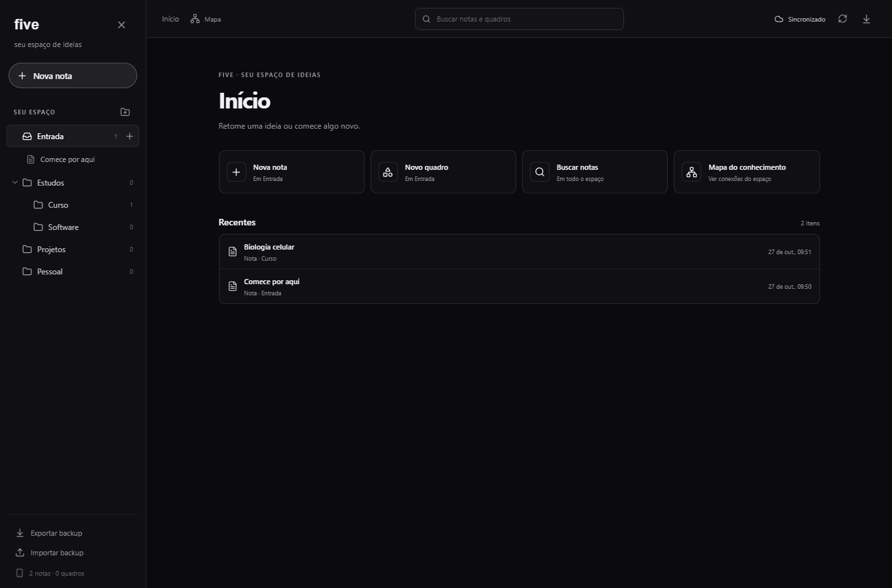
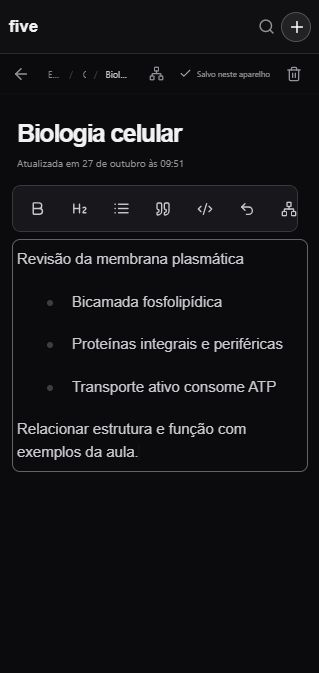

# five

Um caderno pessoal, local-first e de código aberto para notas, estudos e projetos. Organize notas e quadros em pastas, conecte referências e use a busca local. O navegador grava no aparelho primeiro; um Worker e Cloudflare D1 podem sincronizar os aparelhos quando você configurar sua própria conta.


## Recursos

- Editor visual de Markdown, pastas aninhadas, notas e quadros Excalidraw.
- Referências entre notas e quadros, backlinks e mapa do conhecimento.
- Salvamento automático em IndexedDB, PWA instalável e uso offline.
- Fila local durável para sincronização posterior e preservação de conflitos.
- Busca local, itens recentes, organização por menu e arrastar no desktop.
- Importação e exportação de backup JSON.
- Worker opcional para sincronizar entre dispositivos com Cloudflare D1 e Access.

## Capturas

Estas imagens foram feitas em uma sessão temporária do navegador com conteúdo de exemplo fictício.

### Computador



### Interface móvel



O Five é um caderno pessoal. Não oferece colaboração simultânea, compartilhamento por nota, anexos binários, IA ou pesquisa semântica. A busca cobre os dados disponíveis no aparelho. O backup JSON é legível e não é criptografado pelo aplicativo.

## Criar sua cópia

Use **Use this template → Create a new repository** no GitHub para criar um repositório seu. Clone a cópia que acabou de criar. Isso inicia seu projeto sem o histórico de configuração de outra instalação.

## Requisitos

- Node.js 22.12 ou mais recente (o teste local foi feito com Node 24.22.1).
- pnpm 11.25.0, a versão usada para validar este template.
- Git.

Confira as versões:

```sh
node --version
pnpm --version
```

Se ainda não tiver pnpm, instale a versão validada com npm:

```sh
npm install --global pnpm@11.25.0
```

## Rodar localmente

Na raiz do projeto, copie a configuração de exemplo para o arquivo pessoal ignorado pelo Git.

**Windows PowerShell:**

```powershell
Copy-Item wrangler.example.jsonc wrangler.jsonc
pnpm install
pnpm db:migrate:local
pnpm dev
```

**macOS ou Linux:**

```sh
cp wrangler.example.jsonc wrangler.jsonc
pnpm install
pnpm db:migrate:local
pnpm dev
```

Abra a URL local exibida pelo Vite. A cópia local usa armazenamento local do Wrangler em `.wrangler/`; não precisa de conta Cloudflare. O arquivo `wrangler.jsonc` e o estado local são ignorados pelo Git. Sem uma configuração remota, a sincronização aparece como **Só neste aparelho**.

No Windows, depois da instalação inicial, você também pode iniciar o Vite com duplo clique em `Iniciar five.cmd`.

## Testes e build

```sh
pnpm test
pnpm build
```

Para o teste integrado do Worker e D1 local, deixe `pnpm dev` rodando em outro terminal e execute:

```sh
pnpm test:integration
```

## Configurar sua própria sincronização Cloudflare

A configuração remota é opcional. Para manter dados entre dispositivos, configure seus próprios recursos seguindo [docs/cloudflare-setup.md](docs/cloudflare-setup.md). Esse guia cria um Worker e banco D1 na sua conta e protege o Worker com Cloudflare Access. Não reutilize IDs, secrets ou bancos de outra instalação.

Você pode testar o Five localmente antes de configurar a nuvem. Faça backup pelo menu **Exportar backup** antes de trocar de aparelho ou testar importações.

## Instalar no iPhone

Depois de publicar seu Worker em HTTPS, abra o endereço no Safari e escolha **Compartilhar → Adicionar à Tela de Início**. Cada aparelho mantém uma cópia local e envia as alterações quando a conexão volta. Exporte backups de tempos em tempos.

## Personalizar o Five

- Edite as pastas e a nota de boas-vindas em `src/lib/database.ts`.
- Atualize os IDs correspondentes em `src/lib/types.ts` ao personalizar pastas iniciais.
- Altere nome, cores e metadados de instalação em `index.html`, na configuração `manifest` de `vite.config.ts` e nos ícones de `public/`.
- Personalize o nome do Worker e do banco no seu arquivo local `wrangler.jsonc`.

Mantenha os IDs iniciais estáveis depois de distribuir uma versão: os navegadores existentes podem já ter criado essas pastas.

## Arquitetura e decisões

- [Arquitetura, API e dados](docs/architecture.md)
- [Decisões de interface](docs/ui-ux.md)
- [Pesquisa REA e decisões inspiradas em Obsidian, Notion e Notas do iOS](docs/research-rea-ux.md)
- [Configuração Cloudflare](docs/cloudflare-setup.md)
- [Avisos de terceiros](THIRD-PARTY-NOTICES.md)

O aplicativo é uma aplicação React/Vite, um Cloudflare Worker e um D1 opcional. O navegador é o cliente offline e mantém a fila local de sincronização.

## Licença

Este projeto está sob a licença MIT. Veja [LICENSE](LICENSE). Componentes de terceiros mantêm seus próprios avisos em [THIRD-PARTY-NOTICES.md](THIRD-PARTY-NOTICES.md).
