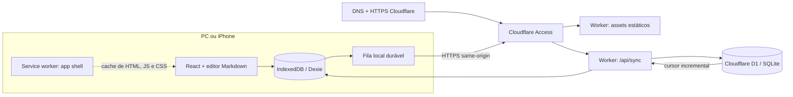

# Arquitetura do five

## 1. Entender o problema

O five é um caderno pessoal usado em três clientes: computador do trabalho, computador de casa e iPhone. A prioridade é capturar notas sem fricção, organizá-las depois e reencontrar conceitos por busca ou links. A rede pode cair e o app precisa continuar aceitando escrita.

### Requisitos funcionais

1. Criar, editar e excluir logicamente notas.
2. Organizar notas em pastas aninhadas, começando pela Entrada.
3. Buscar por título e corpo.
4. Conectar notas e consultar links de saída e backlinks.
5. Salvar no aparelho sem depender da rede e sincronizar mudanças entre aparelhos.
6. Importar e exportar backup.

### Requisitos não funcionais e metas

- Escrita local continua disponível offline; a nuvem é eventual, não bloqueia o editor.
- A aplicação deve funcionar em navegadores de computador e iPhone; HTTPS é requisito para instalação PWA no iPhone.
- Acesso remoto é privado, autenticado pelo Cloudflare Access.
- O escopo inicial é um proprietário e poucas sessões ativas, sem edição colaborativa.
- Não prometemos latência fixa entre aparelhos; com o app aberto, a verificação ocorre na inicialização, retorno ao primeiro plano e a cada 30 segundos. A sincronização também pode ser iniciada manualmente.

## 2. Estimativa de carga

Hipótese para dimensionar o MVP: 1 pessoa, 3 aparelhos, 20 gravações por dia, nota média de 5 KiB. Isso representa cerca de 100 KiB de conteúdo enviado por dia (36 MiB/ano de tráfego de escrita antes de respostas e repetições). Mesmo que cada aparelho baixe as mudanças, a ordem de grandeza é pequena para um Worker e D1. O banco guarda o estado corrente das notas mais uma linha no log e um recibo por operação aceita.

Os números reais dependem da frequência de edição e do tamanho das notas. O cliente envia o conteúdo atualizado da nota, não deltas de caracteres. Se o acervo crescer para dezenas de milhares de notas ou houver muitos usuários e escrita contínua, mediremos payload, latência e crescimento de `change_log`/`sync_ops` antes de rever a arquitetura.

## 3. Componentes e percurso de uma gravação



1. O editor atualiza IndexedDB e o outbox no mesmo aparelho. A interface confirma a gravação sem esperar rede.
2. Quando online, o cliente envia operações agrupadas para `POST /api/sync`.
3. O Worker confere o JWT do Access, valida os dados e tenta aplicar cada escrita com revisão otimista em D1.
4. Operações aceitas recebem um recibo idempotente, incrementam a revisão e entram em `change_log`.
5. O cliente confirma o outbox e busca mudanças posteriores ao próprio cursor. Ao voltar a ficar visível, ele sincroniza de novo.

O Worker e os assets estáticos são implantados juntos. A borda Cloudflare faz DNS, TLS e roteamento; o Worker separa `/api/*` do app. Não há um API Gateway separado nem balanceador administrado pelo projeto.

## 4. Dados

O esquema está em `migrations/0001_initial.sql`.

| Tabela | Campos centrais | Papel |
|---|---|---|
| `folders` | `id`, `parent_id`, `name`, `sort_order`, `revision`, `updated_at`, `deleted_at` | Árvore de pastas; remoção lógica |
| `notes` | `id`, `folder_id`, `title`, `body_md`, `revision`, `updated_at`, `deleted_at` | Conteúdo Markdown e localização |
| `sync_ops` | `op_id`, `device_id`, `entity`, `entity_id`, `accepted_revision` | Recibo para deduplicar reenvio após timeout |
| `change_log` | `sequence`, `entity`, `entity_id`, `revision`, `updated_at` | Cursor incremental por dispositivo |

IDs são UUIDs no cliente. A versão corrente é mantida na tabela de entidade. `revision` não é um histórico de conteúdo; serve para compare-and-set (`UPDATE ... WHERE id = ? AND revision = ?`). `deleted_at` mantém tombstones para que a exclusão também sincronize. Os índices cobrem árvore de pastas, listagem por pasta e paginação do log.

O IndexedDB local tem tabelas equivalentes, mais `outbox` e `settings` para o cursor e o estado inicial da sincronização. Na primeira sincronização, o cliente baixa o servidor antes de publicar pastas iniciais com IDs fixos, evitando criar a mesma estrutura várias vezes.

## 5. API

Todas as rotas `/api/*` exigem uma sessão Cloudflare Access válida fora do host local.

### `GET /api/health`

Retorna `200 { "status": "ok" }`; o cliente usa isso para saber se a API de nuvem está disponível.

### `POST /api/sync`

Pedido (máximo 50 operações e 8 MB por requisição):

```json
{
  "deviceId": "uuid-do-aparelho",
  "cursor": 42,
  "operations": [
    {
      "opId": "uuid-da-operacao",
      "deviceId": "uuid-do-aparelho",
      "entity": "note",
      "entityId": "uuid-da-nota",
      "baseRevision": 3,
      "data": { "id": "uuid-da-nota", "folderId": null, "title": "Cache", "body": "..." },
      "updatedAt": "2026-10-01T12:00:00.000Z"
    }
  ]
}
```

A resposta leva `acks`, `conflicts`, até 200 `changes`, o novo `cursor` e `hasMore`. Respostas de mudanças são limitadas por tamanho para não enviar páginas enormes. O cliente repete páginas e lotes enquanto houver trabalho.

### `GET /api/export`

Entrega um backup JSON do D1, protegido pelo Access. O botão Exportar gera também um backup local e funciona sem rede.

## 6. Concorrência, correção e entrega

- **Entrega:** pelo menos uma vez. Timeout pode fazer o mesmo pedido ser reenviado.
- **Deduplicação:** `opId` é chave primária em `sync_ops`; o mesmo dispositivo/operação recebe o mesmo ACK se repetir.
- **Concorrência:** revisão esperada no `UPDATE` impede sobrescrever silenciosamente uma mudança feita em outro aparelho.
- **Conflito:** se a revisão mudou, o Worker devolve o estado remoto. O cliente mantém o remoto na nota original e grava a edição local como cópia “Conflito — …”. Pastas levam os filhos para uma cópia preservada.
- **Ordem:** operações de criação de pastas são enviadas antes das notas que dependem delas.
- **Transação:** mutation, entrada no `change_log` e recibo são uma única operação `D1.batch`; não há confirmação falsa se o conjunto falhar.

Não alegamos *exactly once*: um cliente pode reenviar e uma requisição pode ter resposta perdida. A idempotência transforma esses reenvios em resultado seguro.

## 7. Como seus conceitos de System Design se aplicam

| Conceito das anotações | Aplicação no five |
|---|---|
| Requisitos funcionais e não funcionais | Captura, busca e conexão; escrita offline, privacidade e leitura entre aparelhos |
| SQL vs NoSQL / ACID vs BASE | D1/SQLite para relações simples, revisão e transação atômica. A sincronização entre aparelhos é eventual (BASE no sentido da experiência distribuída), embora cada transação SQL no banco tenha garantias locais |
| Partições e shards | Não necessários no volume pessoal. D1 gerencia distribuição; particionar por usuário/tenant seria uma decisão posterior |
| Cache | IndexedDB é a cópia de leitura/escrita local e principal durante offline. O service worker guarda só os arquivos do app; nenhuma nota é colocada em cache HTTP compartilhado |
| Filas e jobs | O outbox do IndexedDB é a fila durável do cliente. Worker processa em tempo de requisição; não há fila de servidor nem worker consumidor porque não existe trabalho pesado assíncrono |
| At-least-once e idempotência | Reenvio de operação com `opId` estável até receber ACK |
| CQRS e event sourcing | Não usamos CQRS. `change_log` é um log de replicação incremental, não a fonte de verdade/event sourcing; as tabelas `notes` e `folders` são o estado autoritativo |
| Load balancer / API Gateway | Cloudflare roteia e escala o Worker na plataforma; o próprio Worker envia `/api/*` à API. Não mantemos LB/API Gateway separado |
| Serverless vs servidor | Worker + D1 combinam com carga pequena e irregular; sem máquina sempre ligada, pool de conexões ou patch de SO |
| Monólito vs microsserviços | Um app + Worker + banco, simples de implantar e observar. Microsserviços só adicionariam falhas de rede e operação agora |
| DNS, WAF e rate limit | URL do Worker resolve pelo DNS Cloudflare; Access é a barreira de identidade. Não precisamos expor uma API pública anônima; rate limiting dedicado pode entrar se houver público externo |
| Blob, CDN e invalidação | Sem anexos, logo sem blob store. Assets são publicados com o Worker e servidos pela rede Cloudflare; o app shell atualiza pelo service worker |
| N+1, celebrity e fanout | Não há relações carregadas pela API por nota nem tráfego de influenciador. Backlinks são calculados localmente; fanout não existe sem colaboração ou assinantes |
| WebSocket | Desnecessário sem edição colaborativa. Verificação periódica e ao retornar para o app é suficiente; WebSocket também aumenta estados de conexão e o Cloudflare Access para Worker tem limitações específicas |
| Client pooling | Não criamos pool no navegador ou Worker. `fetch` usa HTTPS do browser e o binding gerenciado de D1; uma conexão global persistente seria inadequada no modelo serverless |

## 8. Gargalos e evolução

1. **Busca linear no navegador:** suficiente para uma coleção individual moderada; adicionar índice local (por exemplo, MiniSearch) quando a busca ficar lenta.
2. **Payload completo por edição:** simples e robusto para notas pequenas. Para notas muito grandes, separar blocos, comprimir ou sincronizar deltas após medir o uso.
3. **Retenção do log e recibos:** `change_log`/`sync_ops` crescem com escritas. Em uso prolongado maior, registrar o cursor dos dispositivos e fazer compactação segura de recibos/logs antigos.
4. **Vários usuários:** hoje o Access limita a app pessoal, mas as tabelas não têm `user_id`. Antes de convidar outra pessoa, separar todos os dados por tenant e adicionar autorização por usuário no Worker.
5. **Colaboração simultânea:** requer protocolo para edição concorrente (CRDT/OT), presença e talvez WebSocket; não é seguro simplesmente adicionar sockets ao modelo atual de nota inteira.
6. **Arquivos grandes:** usar R2 ou outro Blob Store, URLs assinadas e política de acesso; não inserir binários em D1.

Métricas úteis antes de escalar: tamanho dos outboxes, bytes enviados por lote, conflitos, tempo de `/api/sync`, tamanho de D1 e quantidade de linhas de log/recibo.
